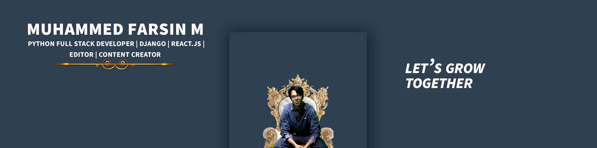

  

# Hi, I'm Farsin 👋

### AI-Integrated Python Django Full Stack Developer Trainee | Django REST Framework | MySQL

I'm a developer focused on building practical web applications and REST APIs. I'm continuously improving my programming skills and exploring backend development.

- 🔭 Currently learning Django REST Framework and MySQL
- 🌱 Improving my Python programming and problem-solving skills
- 💻 Building REST APIs with CRUD operations, authentication, filtering, and data aggregation
- 🤝 Interested in collaborating on meaningful software projects
- 📫 Email: [thefarsin12@gmail.com](mailto:thefarsin12@gmail.com)
- 💼 LinkedIn: [Connect with me](https://www.linkedin.com/in/thefarsii/)

## 🌐 SOCIAL LINKS

  
  
  
  
  
  
  

## 💻 TECH STACK

  
  
  
  

## ⚙️ DEVELOPER TOOLS

  
  
  

## 🚀 FEATURED PROJECTS

### Spend Wise — Expense Tracker

A personal expense management application for tracking expenses, analyzing spending patterns, and planning budgets.

- Expense management with CRUD operations
- Daily and monthly expense summaries
- Category-wise expense analysis
- AI-assisted monthly budget planning

**Tech Stack:** Python · Django REST Framework · MySQL · Gemini API

🔗 [View Repository](https://github.com/thefarsin12-afk/Spend_Wise)

### Fit Wise — Calorie Tracker

A calorie tracking application for managing meals, monitoring calorie intake, and supporting diet planning.

- Meal management with CRUD operations
- Daily and monthly calorie summaries
- Category-wise meal tracking
- AI-assisted diet planning

**Tech Stack:** Python · Django REST Framework · MySQL · Gemini API

🔗 [View Repository](https://github.com/thefarsin12-afk/Food_Log)

---

## 📊 GitHub Stats

  

## 🎯 CURRENTLY FOCUSING ON

- Strengthening Python and Django REST Framework skills
- Improving SQL queries and database design
- Practising problem-solving and writing clean code
- Building reliable backend applications

---

  <i>Build consistently. Improve continuously.</i>

